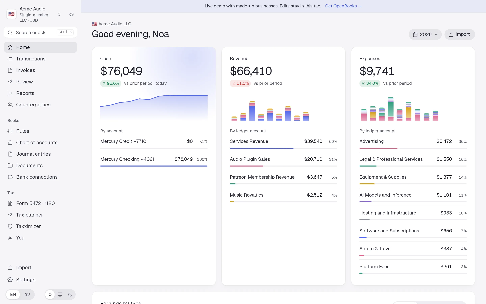
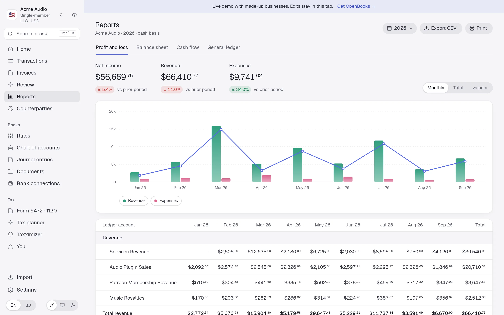
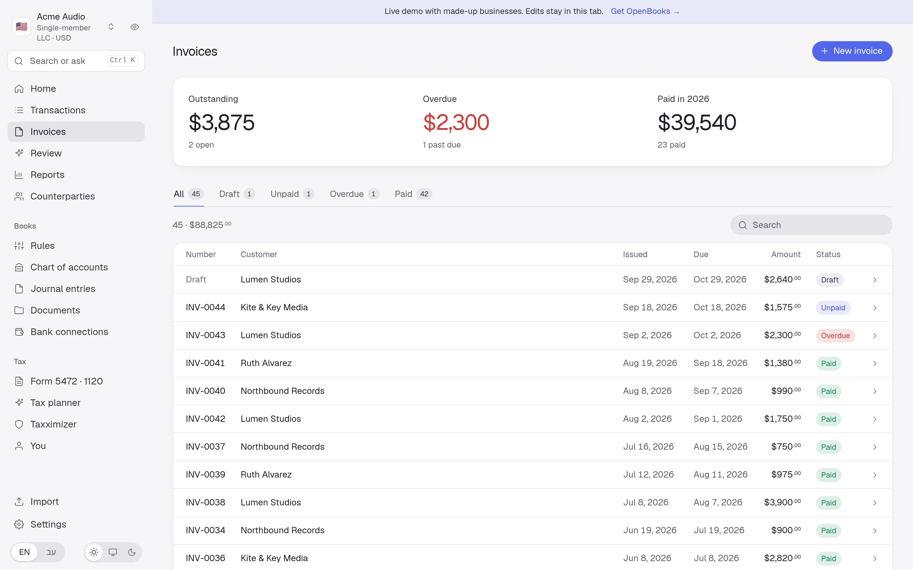
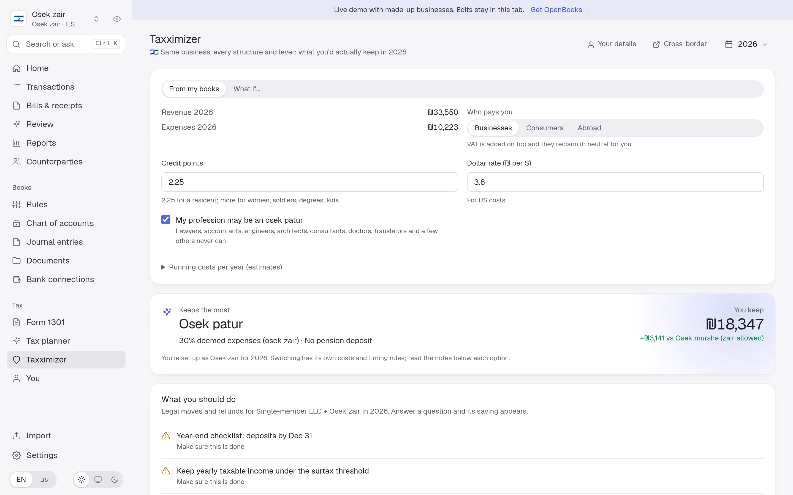
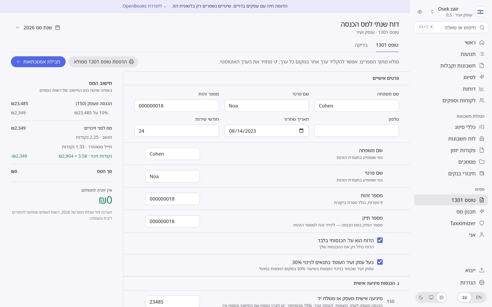

<div align="center">

# OpenBooks

**Bookkeeping and tax that live on your computer.**<br>
Bank sync, invoices, reports and tax forms for freelancers, Israeli osek and US LLCs. No account, no cloud, no subscription.

[**Live demo →**](https://derpcatmusic.github.io/openbooks/demo/) · [**Use it in your browser →**](https://derpcatmusic.github.io/openbooks/app/) · [Website](https://derpcatmusic.github.io/openbooks/) · [Download](https://github.com/DerpcatMusic/openbooks/releases/latest)

<picture>
  <source media="(prefers-color-scheme: dark)" srcset="site/img/home-dark.webp">
  
</picture>

</div>

<!-- derpcat-support -->
<p align="center">
  <a href="https://www.patreon.com/derpcatmusic">
    
  </a>
</p>
<!-- /derpcat-support -->

## Why OpenBooks

|  |  |
|---|---|
| **Bank sync** | Mercury API, Plaid with your own keys (US, Canada, UK, EU), Israeli banks and cards (Hapoalim, Leumi, Discount, Max, Cal, One Zero…), bit, any bank's CSV |
| **Transactions** | Filter by account, tag, method, review state or text. Bulk edit, split one payment across several ledger accounts, mark reviewed |
| **Rules & review** | "If / then" rules classify once and stick, and can add tags. A keyboard-first queue clears the rest |
| **Tags & smart tax tags** | Tag groups (one tag per group), colours, and tags that carry a tax meaning: 50% meals, a trip with a companion, a business-use share |
| **Invoices, bills, vendors** | US invoices, Israeli חשבון עסקה / קבלה / חשבונית מס, customers and vendors. Payments match in full or in part, including the bills you owe |
| **Reports** | P&L, balance sheet (US books), cash flow and cash flow analysis, general ledger, AR and AP aging. Cash basis; monthly, quarterly or total, vs last year, CSV |
| **Books** | Editable chart of accounts, journal entries (paste from a spreadsheet), monthly reconciliation against the statement, a close date that locks finished periods |
| **Tax** | 🇮🇱 Form 1301 over the official form, proof pack, osek zair planner · 🇺🇸 Form 5472 + pro forma 1120 |
| **Taxximizer** | Compare business structures, then see what your receipts are worth: sourced Israeli and US deduction rules per expense, caps, missing receipts, and "tag these" suggestions you apply in one click |
| **⌘K + AI** | Jump anywhere, run actions, ask your books with your own key or a local model |
| **MCP** | Claude and other MCP clients read your books and propose changes you approve |
| **Private** | One SQLite file. Secrets sealed with AES-256-GCM. Listens on 127.0.0.1 only |

English and Hebrew (RTL), light and dark, and a privacy mode that scrambles every number for screen-shares. Israeli bank sync needs Chrome or Chromium installed.

The deduction rules are researched and cite their sources, and each says how firm it is (statute, regulation, practice). They are a guide for your bookkeeping, not a tax position: the US side covers per-expense rules, not self-employment tax, QBI or state tax.

## Quick start

```bash
./openbooks              # download from Releases → http://127.0.0.1:8765
```

From source, with [Bun](https://bun.sh):

```bash
bun install && (cd apps/web && bunx vp build)
bun apps/server/src/main.ts
OPENBOOKS_HOME=examples/showcase bun apps/server/src/main.ts   # with the demo's sample books
```

As an app with its own window and icon, always on the latest `main`:

```bash
scripts/app.sh             # update, rebuild if needed, (re)start the server, open an app window
scripts/app.sh --install   # Linux: add OpenBooks to your app menu / dock (it runs the line above)
scripts/app.sh --stop      # stop the server
```

Each launch fast-forwards the checkout to `origin/main` (skipped if you have local edits or your own commits), rebuilds when the commit changed, and restarts the server on the new build. Books go to `~/openbooks` unless `OPENBOOKS_HOME` says otherwise. Any Chromium browser (Chrome, Edge, Brave, Helium) can also install the open page with "Install app". There is no service worker, so the window always shows the build the server has now.

| Env | Default | |
|---|---|---|
| `OPENBOOKS_HOME` | `./entities` | `books.db` plus each business's statements and documents |
| `OPENBOOKS_PORT` | `8765` | Local port (127.0.0.1 only) |

## Screens

<table>
<tr>
<td><picture><source media="(prefers-color-scheme: dark)" srcset="site/img/reports-dark.webp"></picture></td>
<td><picture><source media="(prefers-color-scheme: dark)" srcset="site/img/invoices-dark.webp"></picture></td>
</tr>
<tr>
<td><picture><source media="(prefers-color-scheme: dark)" srcset="site/img/taxximizer-dark.webp"></picture></td>
<td><picture><source media="(prefers-color-scheme: dark)" srcset="site/img/tax-il-dark.webp"></picture></td>
</tr>
</table>

## Use it from Claude

```bash
claude mcp add openbooks -- /path/to/openbooks mcp
```

Reads run on their own; anything that changes the books waits for your approval. 28 tools, among them:

- **Read:** `list_transactions`, `profit_and_loss`, `balances`, `list_invoices`, `list_bills`, `aging_report` (AR or AP by due date), `deduction_summary` (what the rules let you deduct, receipts missing, money left on the table), `suggest_tax_tags`, `tax_summary`, `us_tax_estimate` (Schedule C, SE, QBI, 1040-ES, corporate and K-1 figures), `prepare_1099s` (who needs a 1099-NEC)
- **Propose (approved by you):** `classify`, `set_rules`, `split_transaction`, `apply_tax_tag`, `add_journal_entry`, `create_invoice`, `draft_bill`

Details in [docs/mcp.md](docs/mcp.md).

## Develop

```bash
bun install
bun run test && bun run check && bun run typecheck
bun apps/server/build.ts          # single binary → dist/
bun scripts/demo/build.ts         # website + demo + browser-only app → _site/
```

Bun · SvelteKit · Tailwind 4 · Effect · SQLite. Architecture: [docs/architecture.md](docs/architecture.md).
Country packs live in `packages/countries/*`. Other countries' tax tables, bank formats and translations are welcome.

---

<sub>OpenBooks is a tool, not tax advice. Have a professional review anything you file. [AGPL-3.0](LICENSE).</sub>
